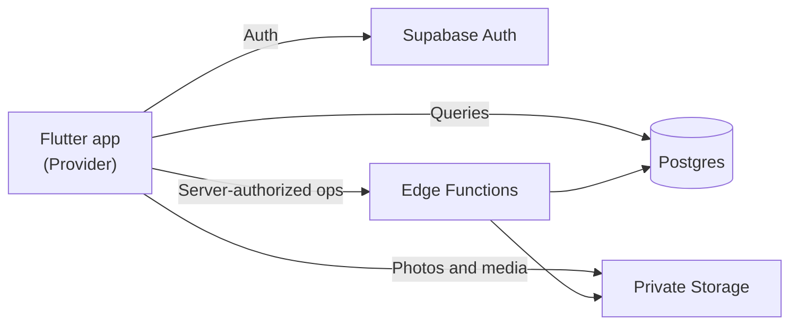

<div align="center">


# P Attendance

**Photo check-ins, location evidence, and office-specific attendance management for teams.**

[](https://flutter.dev)
[](https://dart.dev)
[](https://supabase.com)
[](#status)

[](https://github.com/Umerjamshaid/Attendance-app/stargazers)
[](https://github.com/Umerjamshaid/Attendance-app/network/members)
[](https://github.com/Umerjamshaid/Attendance-app/issues)
[](https://github.com/Umerjamshaid/Attendance-app/commits/main)
[](https://github.com/Umerjamshaid/Attendance-app/actions/workflows/attendance-site.yml)

[Demo](#try-the-demo) ·
[Screenshots](#screenshots) ·
[Features](#features) ·
[Architecture](#architecture) ·
[Backend setup](attendance/docs/backend-setup.md) ·
[Contributing](#contributing)

</div>

---

## What is this, really?

P Attendance is a Flutter app where employees check in with a photo and verified location, and administrators manage attendance inside their own offices.

It started as an interface project and grew into a working app: authenticated accounts, a Supabase backend, and multi-office access. Employees record and review their check-ins. Admins set the rules, filter the roster, and inspect the evidence.

---

## Screenshots

<table>
  <tr>
    <td align="center" width="20%">
      <br>
      <sub><strong>Check-in</strong></sub>
    </td>
    <td align="center" width="20%">
      <br>
      <sub><strong>History</strong></sub>
    </td>
    <td align="center" width="20%">
      <br>
      <sub><strong>Administration</strong></sub>
    </td>
    <td align="center" width="20%">
      <br>
      <sub><strong>Profile</strong></sub>
    </td>
    <td align="center" width="20%">
      <br>
      <sub><strong>Settings</strong></sub>
    </td>
  </tr>
</table>

<p align="center"><sub>Current Android interface.</sub></p>

---

## Features ✨

- **Photo and location check-ins.** Capture a photo with GPS coordinates, a timestamp, and device information. Evidence can show a readable address when available.
- **Mock-location detection.** Spoofed GPS gets flagged instead of silently accepted.
- **Separate offices, one account.** Switch between authorized offices, each with its own employees, settings, records, and permissions.
- **Attendance at a glance.** Today's status, monthly progress, streaks, and a chronological history.
- **Practical administration.** Filter the roster, view profile photos, set attendance windows, and inspect check-in logs and evidence.
- **Office-specific access.** Invite employees and manage roles through server-authorized operations.
- **Personal profiles.** Photos, cover images, and tags. Avatars and banners up to 5 MB; animated GIF banners up to 10 MB.
- **Light and dark themes** with soft gray surfaces, teal accents, bottom sheets, animated icons, and haptic feedback that respects reduced-motion settings.
- **Demo mode.** Explore the whole app with sample data, no account and no permissions.

---

## Status

| ✅ Works today | 🚧 Still in progress |
|---|---|
| Photo and GPS check-ins | Physical-device acceptance testing |
| Multi-office accounts and switching | iOS verification |
| Admin roster, attendance windows, evidence logs | |
| History, streaks, monthly progress | |
| Profile media with per-viewer caching | |
| Light and dark themes | |
| Demo mode | |
| Android release builds and local automated tests | |

<sub>This is an actively developed showcase and pilot. Nothing here implies iOS verification yet.</sub>

---

## Try the demo

You need a Flutter SDK compatible with Dart `^3.11.4`, plus an Android device or emulator.

```sh
git clone https://github.com/Umerjamshaid/Attendance-app.git
cd Attendance-app/attendance
flutter pub get
flutter run
```

Tap **Explore demo** on the sign-in screen. No account needed. The preview uses sample data, requests no camera or location access, and uploads nothing. Editing and submissions are disabled in this mode.

Live office access is invitation-only. For a trial, contact [Umer Jamshaid](https://github.com/Umerjamshaid). To connect your own Supabase project, follow the [backend setup guide](attendance/docs/backend-setup.md).

---

## Architecture



| Area | Implementation |
|---|---|
| Application | Flutter and Dart |
| State management | Provider |
| Backend | Supabase Auth, Postgres, private Storage, Edge Functions |
| Capture and location | image_picker, Geolocator, reverse geocoding |
| Interface | Bundled typography, Tabler icons, selected animated Lucide icons |
| Profile media | cached_network_image, flutter_cache_manager |

<details>
<summary><strong>Repository layout</strong></summary>

```
Attendance-app/
├── attendance/          # the Flutter app
│   ├── docs/            # backend setup, design notes, attribution
│   └── screenshots/
├── docs/                # contributor workflow
├── site/                # project site
└── .github/workflows/   # CI
```

</details>

<details>
<summary><strong>Development commands</strong></summary>

Run from `attendance/`:

```sh
flutter analyze
flutter test
flutter build apk --release --split-per-abi --target-platform android-arm64
```

Without backend configuration, the build opens the demo-capable sign-in flow. Live builds need the configuration from the setup guide.

</details>

---

## FAQ

**Do I need an account to try it?**
No. Choose **Explore demo** on the sign-in screen.

**Does the demo upload anything or ask for permissions?**
No. It uses sample data and never touches the camera or location.

**Can I run my own backend?**
Yes. The [backend setup guide](attendance/docs/backend-setup.md) walks through connecting your own Supabase project.

**Is there an iOS build?**
Not verified yet. Android is the supported target for now.

---

## Contributing

Contributions are welcome.

1. **Start from an issue.** Open one first so the change is agreed before the code exists.
2. **Fork and branch from `main`.**
3. **Follow the [Git and PR workflow](docs/git-pr-workflow.md).**
4. **Run `flutter analyze` and `flutter test`** before opening a PR.

Keep passwords, access tokens, and employee evidence out of public issues and screenshots.

---

## Security

If you find a vulnerability, please report it privately through [GitHub security advisories](https://github.com/Umerjamshaid/Attendance-app/security/advisories/new) instead of opening a public issue.

---

## Design inspiration

The interface is heavily inspired by [Block Buzz](https://github.com/block/buzz/tree/main/mobile), especially its office and community switching, bottom sheets, typography, navigation, and action feedback. Those ideas are adapted to Attendance's workflows and Provider architecture. Buzz's backend and identity system are not used.

See [design and animation attribution](attendance/docs/third-party-animations.md) for upstream references, modifications, and bundled license notices.

---

## Contributors

<a href="https://github.com/Umerjamshaid/Attendance-app/graphs/contributors">
  
</a>

## Star history

<a href="https://star-history.com/#Umerjamshaid/Attendance-app&Date">
  
</a>

---

<p align="center">
  <sub>Built by <a href="https://github.com/Umerjamshaid"><strong>Umer Jamshaid</strong></a></sub>
</p>