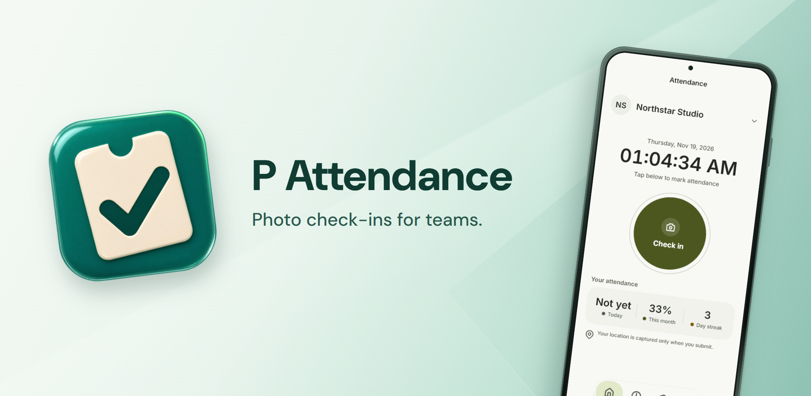
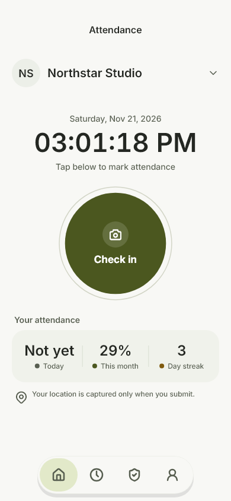
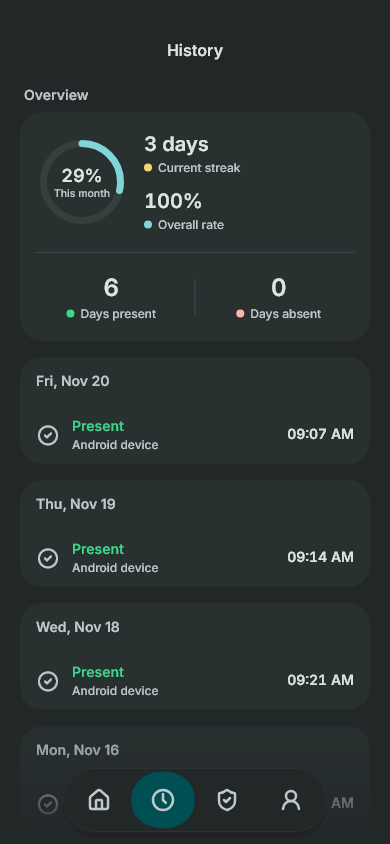
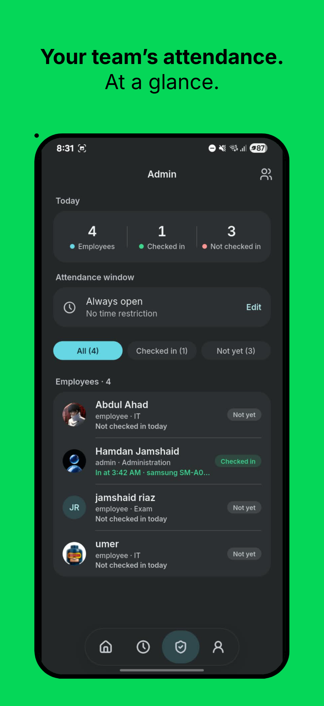
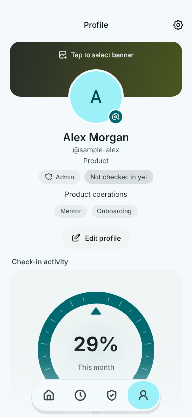

# P Attendance



A Flutter attendance app for teams, combining photo check-ins, location evidence, and office-specific attendance management.

P Attendance started as an interface project and has grown into a working app with authenticated accounts, a Supabase backend, and multi-office access. Employees can record and review their check-ins, while administrators manage attendance within their own offices.

[Try the demo](#try-the-demo) | [Screenshots](#screenshots) | [Development](#development)

## Screenshots

Current Android interface, shown in presentation device frames. Select an image to view it at full size.

<table>
  <tr>
    <td align="center"><a href="attendance/screenshots/current/attendance.png"></a><br><strong>Check-in</strong></td>
    <td align="center"><a href="attendance/screenshots/current/history.png"></a><br><strong>History</strong></td>
    <td align="center"><a href="attendance/screenshots/current/admin.png"></a><br><strong>Administration</strong></td>
  </tr>
  <tr>
    <td align="center"><a href="attendance/screenshots/current/profile.png"></a><br><strong>Profile</strong></td>
    <td align="center"><a href="attendance/screenshots/current/settings.png"></a><br><strong>Settings</strong></td>
    <td></td>
  </tr>
</table>

## Features

- **Photo and location check-ins.** Capture a photo with verified GPS coordinates, a timestamp, and device information. Evidence can also show a readable address when available.
- **Separate offices, one account.** Switch between authorized offices, each with its own employees, attendance settings, records, and permissions.
- **Attendance at a glance.** Review today's status, monthly progress, streaks, and a chronological check-in history.
- **Practical administration.** Filter the employee roster, view profile photos, set attendance windows, and inspect check-in logs and evidence.
- **Office-specific access.** Invite employees and manage roles through server-authorized operations.
- **Personal profiles.** Customize photos, cover images, and tags. Avatars and ordinary banners support up to 5 MB; animated GIF banners support up to 10 MB.

## Interface

Light and dark themes use soft gray surfaces, teal accents, bundled typography, and consistent iconography. The centered navigation supports synchronized taps and swipes. Bottom sheets, selected animated icons, and haptic feedback add motion while respecting reduced-motion settings.

Validation stays beside the relevant field, and short action feedback uses a shared toast. Profile media is cached per signed-in viewer; attendance evidence uses a separate private loading path.

## Try The Demo

Use a Flutter SDK compatible with Dart `^3.11.4`, plus an Android device or emulator.

```sh
git clone https://github.com/Umerjamshaid/Attendance-app.git
cd Attendance-app/attendance
flutter pub get
flutter run
```

Choose **Explore demo** on the sign-in screen. No account is needed. The preview uses sample data, requests no camera or location access, and does not upload anything. Editing and submissions are disabled in this mode.

Live office access is invitation-only. For a trial, contact [Umer Jamshaid](https://github.com/Umerjamshaid). Developers can use the [backend setup guide](attendance/docs/backend-setup.md) to connect their own Supabase project. Keep passwords, access tokens, and employee evidence out of public issues.

## Built With

| Area | Implementation |
| --- | --- |
| Application | Flutter and Dart |
| State management | Provider |
| Backend | Supabase Auth, Postgres, private Storage, and Edge Functions |
| Capture and location | image_picker, Geolocator, and reverse geocoding |
| Interface | Bundled typography, Tabler icons, and selected animated Lucide icons |
| Profile media | cached_network_image and flutter_cache_manager |

## Development

Run these commands from `attendance/`:

```sh
flutter analyze
flutter test
flutter build apk --release --split-per-abi --target-platform android-arm64
```

Without backend configuration, the build opens the demo-capable sign-in flow. Live builds require the configuration described in the setup guide.

This is an actively developed showcase and pilot. Android release builds and automated tests are verified locally; physical-device acceptance and iOS verification remain ongoing. The presentation frames above do not imply iOS verification.

## Design Inspiration

The interface is heavily inspired by [Block Buzz](https://github.com/block/buzz/tree/main/mobile), especially its office/community switching, bottom sheets, typography, navigation, and action feedback. Those ideas are adapted to Attendance's workflows and Provider architecture, rather than bringing across Buzz's backend or identity system.

See [design and animation attribution](attendance/docs/third-party-animations.md) for upstream references, modifications, and bundled license notices.

Built by [**Umer Jamshaid**](https://github.com/Umerjamshaid).
