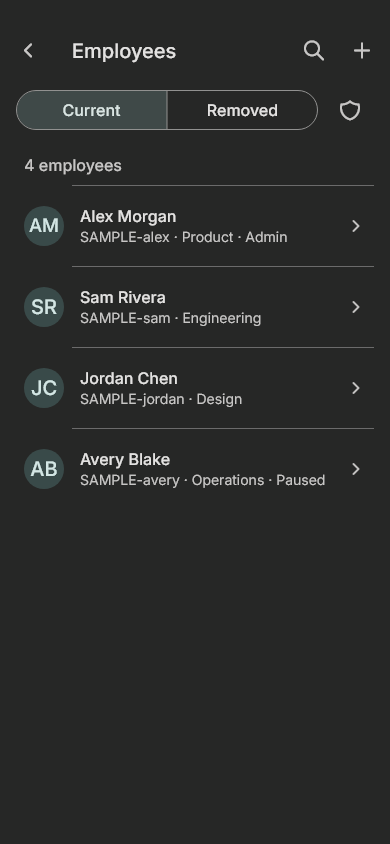
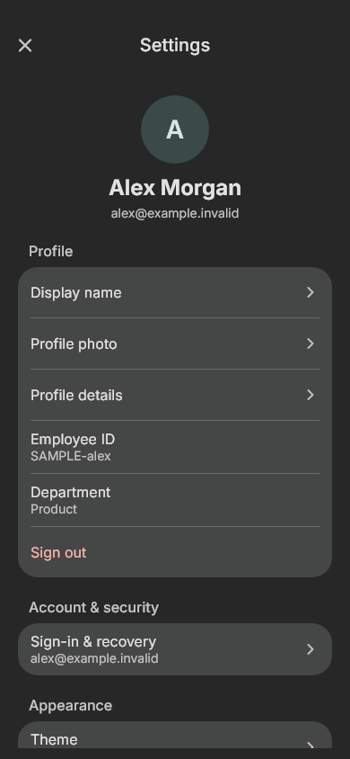

# P Attendance

Photo check-ins and clear attendance records for teams that work across offices.
Employees can check in and review their history. Administrators can manage their
office's roster, attendance window, and check-in evidence.

[Project site](https://umerjamshaid.github.io/Attendance-app/) · [Try the demo](#try-the-demo) · [Screenshots](#screenshots) · [Backend setup](attendance/docs/backend-setup.md)


## Screenshots

Rendered from the app with fictional offices and employees. Select an image to
view it at full size.

<table>
  <tr>
    <td align="center"><a href="attendance/screenshots/current/attendance.png"></a><br><strong>Check-in</strong></td>
    <td align="center"><a href="attendance/screenshots/current/history.png"></a><br><strong>History</strong></td>
    <td align="center"><a href="attendance/screenshots/current/admin.png"></a><br><strong>Admin</strong></td>
  </tr>
  <tr>
    <td align="center"><a href="attendance/screenshots/current/employees.png"></a><br><strong>Employees</strong></td>
    <td align="center"><a href="attendance/screenshots/current/profile.png"></a><br><strong>Profile</strong></td>
    <td align="center"><a href="attendance/screenshots/current/settings.png"></a><br><strong>Settings</strong></td>
  </tr>
</table>

## Features

- **Photo and location check-ins.** Record a photo, checked GPS coordinates, and a timestamp. Evidence can include a readable address when available.
- **Multiple offices, one account.** Switch between offices without mixing their employees, attendance records, or permissions.
- **Attendance history.** See today's status, monthly progress, and streaks.
- **Admin tools.** Set attendance windows, review recent check-ins, and inspect evidence. Remove employees without losing their past check-ins, or reinvite them with a single-use office code.
- **Personal profiles and appearance.** Customize photos, banners, and tags. Choose from four palettes in light or dark mode. After an update, What's New shows the highlights once.

## Try the demo

Use a Flutter SDK with Dart `^3.11.4` and an Android device or emulator:

```sh
git clone https://github.com/Umerjamshaid/Attendance-app.git
cd Attendance-app/attendance
flutter pub get
flutter run
```

Choose **Explore demo**. No account is required. The demo uses sample data and
does not request camera or location access, upload files, or write attendance
records.

Live offices are invitation-only. Contact [Umer Jamshaid](https://github.com/Umerjamshaid)
for access, or follow the [backend setup guide](attendance/docs/backend-setup.md)
to connect your own Supabase project.

## Architecture

The Flutter app uses Provider for UI and session state. Supabase Auth manages
sign-in, Postgres separates office data and enforces permissions, Edge Functions
handle operations such as check-in submission and email invitations, and private
Storage holds media and evidence.

| Path | Contents |
| --- | --- |
| `attendance/` | Flutter app, tests, and Supabase migrations |
| `attendance/docs/` | Backend setup, design notes, and migration guidance |
| `site/` | Public showcase site |
| `docs/` | Contributor and PR workflow |

## Development

From `attendance/`:

```sh
flutter analyze
flutter test
flutter build apk --release --split-per-abi --target-platform android-arm64
```

A build without backend configuration is demo-only. Android builds and local
tests are verified during development; iOS support is not yet verified.
See the [changelog](attendance/CHANGELOG.md) and [employee roster notes](attendance/docs/employee-roster.md)
for recent changes.

## Contributing

Open an issue to discuss the change, then follow the
[Git and PR workflow](docs/git-pr-workflow.md). Keep credentials and real
employee records out of issues and screenshots. Report security issues
[privately](https://github.com/Umerjamshaid/Attendance-app/security/advisories/new).

## Design credits

[Block Buzz](https://github.com/block/buzz/tree/main/mobile) inspired the office
switcher, navigation, bottom sheets, and feedback. Attendance keeps its own
backend and identity system. See the [design and animation attribution](attendance/docs/third-party-animations.md)
for the source and license notices.

Built by [**Umer Jamshaid**](https://github.com/Umerjamshaid).
